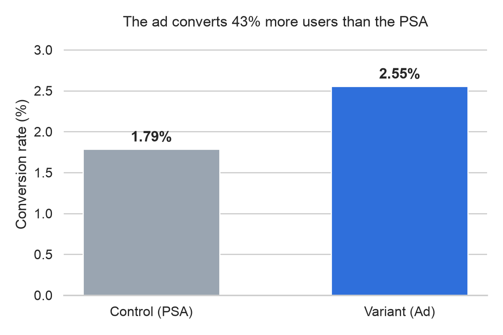
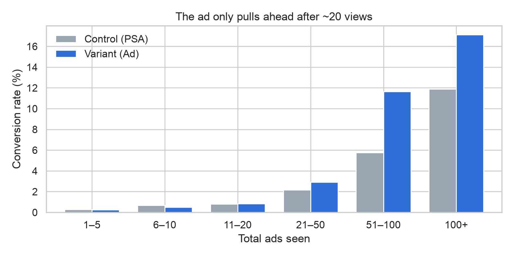

# Should we keep paying for this ad campaign? | A/B Test Analysis

> **Decision:** Keep funding the campaign and test ad frequency before the next budget cycle.
>
> The ad causes **~4,300 extra purchases (+43%)**. It pays for itself if each sale earns more than **~$16 profit** (at a $5 CPM).
> But **~21% of ads shown** go to users who see it too rarely to show any measurable lift.

**[▶ Read the interactive case study](https://kubrabozan.github.io/ab-testing-marketing-campaign/)** · [Notebook](notebooks/ab_test_analysis.ipynb) · [Stats module](src/ab_stats.py)



## The decision this changes

The marketing team has to decide whether to **renew the campaign budget** and **how to spend it**. 3 business questions:

| | Business question | Answer |
|---|---|---|
| **BQ1** | Does the ad *cause* more purchases? | **Yes.** 1.79% → 2.55% conversion, ~4,343 extra purchases (95% CI 3,360 to 5,326) |
| **BQ2** | Is it worth the money? | **Likely.** ~$16 of ad spend per extra purchase at a $5 CPM, so it pays off if profit per sale is higher |
| **BQ3** | Where does it work? | **Only at higher frequency.** No lift for users who saw ≤20 ads (66% of users, 21% of ads shown). Weekday data doesn't support moving budget |

## The data

[Marketing A/B Testing](https://www.kaggle.com/datasets/faviovaz/marketing-ab-testing) (Kaggle): 588,101 users. 96% saw a product **ad** (variant); a 4% hold-out saw a **public-service announcement** in the same slot (control). Each row records whether the user bought, how many ads they saw and the day and hour they saw the most ads. See [data/README.md](data/README.md).

**Caveats:** the dataset's origin is undocumented and may be synthetic. There's no revenue or cost data, so profitability is given as a break-even point. Exposure columns are measured after assignment, so the frequency finding is a hypothesis to test, not a proven effect.

## Key findings

**1. The ad works and 3 methods agree**

| Method | Result |
|---|---|
| Two-proportion z-test | +0.77 pp (95% CI 0.60 to 0.94 pp). If the ad did nothing, random luck alone would produce a gap this large less than 1 in a trillion times, so this is not a fluke |
| Bootstrap (10,000 resamples) | +43% lift (95% CI +31% to +58%) |
| Bayesian Beta-Binomial | P(ad beats PSA) > 99.99% |
| Power check | Observed effect is 3× the smallest detectable effect, so the test was big enough |

**2. Break-even: the campaign showed 14.0M ads and got 0.31 extra purchases per 1,000 ads shown**

There is no separate ad log: the 14.0M comes from adding up the `total ads` column (ads seen per user) for the variant group.

| CPM | Campaign cost | Ad cost per extra purchase |
|---|---|---|
| $2 | $28k | ~$6 |
| $5 | $70k | ~$16 |
| $10 | $140k | ~$32 |

**3. The ad needs repetition** Users who saw 20 or fewer ads show no lift (−3%, p = 0.78). Above 20 views the lift is +56%. That makes frequency the biggest lever and the next thing to test.



**4. Measuring had a small cost** The 4% hold-out "lost" about 181 purchases, under 5% of what the campaign generated. That's the price of knowing the campaign works at all.

## Recommendations
1. **Renew the budget.** The effect is real and large.
2. **Confirm profit per sale with finance.** Above ~$16 (at a $5 CPM), the campaign is profitable.
3. **Run a frequency-cap experiment** (e.g. 10 / 20 / 40 ads) to find the minimum number of views that works.
4. **Keep a small hold-out** in every future campaign.
5. **Don't reallocate by weekday.** After the multiple-testing correction, the evidence doesn't support it.

## Method
Decision framing → dataset & data-quality checks (incl. Sample Ratio Mismatch) → EDA → z-test / chi-square → bootstrap, Bayesian, power → break-even model → frequency & weekday segments (Holm correction) → recommendation.

## How I worked
I used an AI assistant to speed up the coding and the first drafts. I set the business framing, checked every claim against the notebook output and made the judgement calls in the recommendations.

## Project structure
```
├── data/README.md               # dataset source & download instructions
├── notebooks/ab_test_analysis.ipynb
├── src/ab_stats.py              # reusable, tested A/B statistics functions
├── tests/test_ab_stats.py       # pytest suite (validated against statsmodels)
├── reports/figures/             # exported charts
└── docs/                        # GitHub Pages case-study site
```

## Run it yourself
```bash
python -m venv .venv && source .venv/bin/activate
pip install -r requirements.txt
kaggle datasets download -d faviovaz/marketing-ab-testing -p data --unzip
pytest -q
jupyter nbconvert --to notebook --execute --inplace notebooks/ab_test_analysis.ipynb
```

**Skills:** Python · pandas · SciPy · statsmodels · experiment design · hypothesis testing · Bayesian inference · business case modelling · data storytelling
